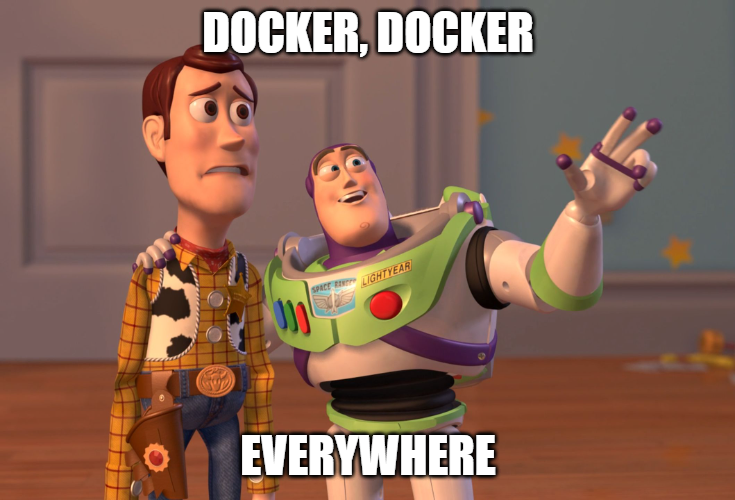

# Whalecome 🐳

A collection of Docker and docker-compose files, sometimes with additional files I use.

## Table of Contents

* [Docker Image Versions](#docker-image-versions)
* [Golang with Live-Reloading](go/README.md)
* [NestJS with development and Multi-Stage production using npm](nestjs-npm/README.md)
* [NestJS with development and Multi-Stage production using yarn](nestjs-yarn/README.md)

## Docker Image Versions

Usually the build section of every Docker Service includes an argument for pulling
a specific image version (e.g., Node.js v18.12).
If no argument is given, it defaults to the ``latest`` tag.

This behaviour can be changed in the ``docker-compose.yml`` or the ``Dockerfile``
respectively.

    

